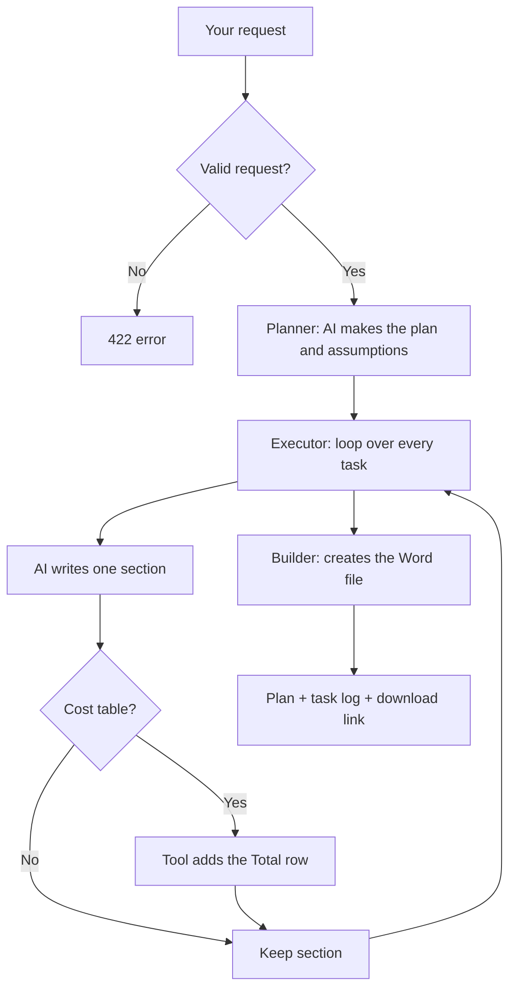

# Autonomous Document Agent

An API that turns one plain-English request into a finished Word document. The agent decides what to write, makes its own task list, writes each section, and returns a `.docx` file.

Built for the Python AI Engineer (Autonomous Agents) 60-minute build challenge.

## What it does

- Plans by itself: picks the document type, writes assumptions, and creates 3 to 8 tasks.
- Writes the document one section at a time.
- Uses a Python tool to add totals to cost tables, because LLMs are unreliable at arithmetic.
- Checks every LLM reply, retries with the error message, and switches to a backup model if needed.
- Handles vague requests by making assumptions and listing them in the document.

## Architecture



## Tech stack

Python 3.12, FastAPI, Uvicorn, Groq (free tier), Pydantic, python-docx, python-dotenv. No LangChain: a plain Python loop is easier to read and debug.

## Project structure

```
main.py            API: POST /agent and GET /download/{filename}
schemas.py         Data shapes: request, plan, task, section, table
llm.py             The only file that talks to the LLM (retry + fallback)
planner.py         LLM makes the plan and assumptions
executor.py        Loops over tasks and writes each section
tools.py           Calculator tool that adds Total rows
docx_builder.py    Builds the Word file
list_models.py     Lists the Groq models your key can use
test_*.py          Manual checks for each layer
```

## How to run

```bash
python -m venv venv
venv\Scripts\activate          # Mac/Linux: source venv/bin/activate
pip install -r requirements.txt
```

Create a `.env` file with your free key from console.groq.com (no quotes, no spaces):

```
GROQ_API_KEY=your_key_here
```

Start the server and open http://127.0.0.1:8000/docs:

```bash
uvicorn main:app --reload
```

Use `POST /agent`, click Try it out, and send a request. It takes 30 to 90 seconds. Then open the `download_url` from the response.

If you get `model_not_found`, run `python list_models.py` and update the `MODELS` list at the top of `llm.py`.

## Test inputs

1. Standard: `Create a project plan for launching a customer support chatbot, 3-month timeline.`
2. Complex (vague, missing data, conflicting words): `Put together something for leadership about why our onboarding is slow. Keep it short but thorough, include costs, we don't have the data yet.`

For the second input the agent did not ask questions. It decided its own assumptions:

```
Assumptions:
  - No actual onboarding data available, so illustrative mock figures and timelines are used.
  - Cost impact estimates are based on industry benchmarks and typical salary rates.
  - Leadership prefers a concise, bullet-point style while still covering root causes and financial implications.
```

## Evidence from my runs

Screenshots are in the `docs/` folder.


*POST /agent response with the plan, assumptions and task log.*

*The executor working through its own task list.*

*The Word file, with the assumptions list and a cost table with a Total row.*

## Engineering improvement: retry and fallback

LLMs sometimes return broken or wrongly shaped JSON, and every step here depends on structured output. So each reply goes through `llm.py`:

1. Ask the model for JSON and check it against a Pydantic schema.
2. If it is invalid, send the model its own answer plus the error message and ask it to fix it (2 attempts per model).
3. If it still fails, switch to the backup model.
4. If everything fails, return a clear error. If only one section fails, the document is still built with a "needs manual review" note.

To see the fallback, put a wrong model name first in `MODELS` and watch the terminal.

## A problem I hit: the tool that never ran

My calculator tool should add totals to cost tables, but the task log showed `tool_used: None` for every task:

```
{'task_id': 4, 'title': 'Cost Impact Analysis', 'status': 'done', 'tool_used': None}
```

Root cause: tables were optional in my prompt, so the model wrote the costs as a paragraph. Fix: if a section title is about cost or budget, a table is now required. That caused a second bug (the tool also fired on the Executive Summary because my check read the description), so I now match the title only.

```
{'task_id': 4, 'title': 'Cost Implications of Delayed Onboarding', 'status': 'done', 'tool_used': 'add_total_row'}
```

Reviewing the Word file later showed another issue: the text said the budget was $75,000 but the table added up to $70,000. The tool was right and the model's own maths was wrong, so the prompt now says table rows must add up to the stated budget.

## Tradeoff: autonomous planning vs fixed rules

The LLM decides what to write, so one agent can produce a project plan or a business report. But more freedom means less predictability: it skipped my tool, invented dates and contradicted its own numbers. So the LLM controls the content, and small fixed rules in code protect the important parts: schema checks, the calculator tool, today's date in the prompt, and bullet cleanup.

## Limits

- It plans once and follows a fixed loop. It does not re-plan if a task fails.
- The tool runs from a code rule, not from native LLM function calling.
- Requests are slow because everything runs inside one API call.
- Figures are illustrative mock data unless real numbers are given.
- The `test_*.py` files are manual checks, not automated tests.

## Future improvements

Quality
- Reflection step: the agent re-reads the finished document and fixes contradictions.
- Native function calling, so the model chooses its own tools.
- Re-planning when a task fails.
- Automated tests with pytest, and proper logging instead of `print`.

Scale
- Return a job id right away and process in a background worker queue.
- Write independent sections in parallel with asyncio.
- Store Word files in cloud storage instead of a local folder.
- Rate-limit handling, caching and a Docker setup.

Features
- Simple RAG: let the agent use a company's own documents and templates.
- Conversation memory, so a user can ask for changes to a finished document.
- More output formats, such as PDF.
